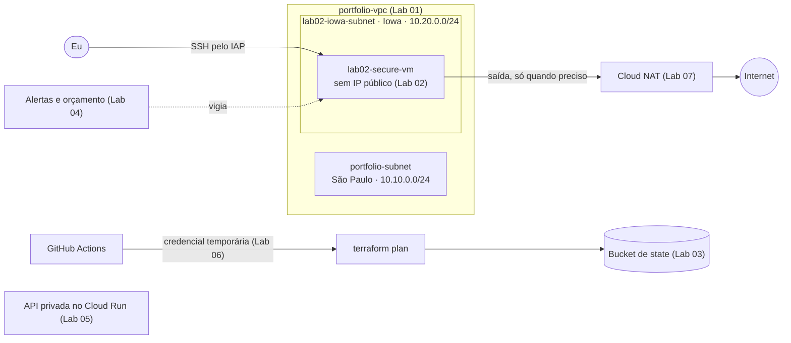

# Portfólio Google Cloud

Labs de Google Cloud feitos com Terraform no meu próprio projeto: cada um foi implantado, testado e documentado com o que fiz e por quê.

[Português](README.md) | [English](README.en.md)

## Em 30 segundos

- **7 labs de Terraform**: rede, VM privada, state remoto, monitoramento, Cloud Run, CI sem chave e Cloud NAT.
- **Tudo implantado de verdade** e testado, com a data e o resultado do teste no README de cada lab.
- **Segurança por padrão**: nenhuma VM com IP público, nenhuma chave de conta de serviço, acesso só pelo IAP.
- **Custo sob controle**: orçamento com alerta e recursos caros ligados só durante o teste.
- **Revisão automática** a cada pull request: validação, análise de segurança (Checkov) e `terraform plan`.

**Por onde começar:** [Lab 02 - VM privada](projects/02-secure-compute-engine/README.md), [Lab 06 - CI sem chave](projects/06-workload-identity-federation/README.md) e [Lab 04 - Alertas e orçamento](projects/04-monitoring-alerts/README.md).

## Labs

| # | Lab | O que resolve | Situação |
| --- | --- | --- | --- |
| 01 | [Rede VPC](projects/01-vpc-network/README.md) | Rede privada com sub-rede planejada | Implantado |
| 02 | [VM privada](projects/02-secure-compute-engine/README.md) | VM sem IP público, acessada só pelo IAP com OS Login | Implantado, acesso testado |
| 03 | [State do Terraform](projects/03-terraform-backend/README.md) | Bucket protegido com versões, trava e roteiro de recuperação | Implantado |
| 04 | [Monitoramento e orçamento](projects/04-monitoring-alerts/README.md) | Alertas de CPU, VM parada e mudança de permissão; orçamento mensal | Implantado, alertas testados |
| 05 | [Aplicação no Cloud Run](projects/05-cloud-run-app/README.md) | API em contêiner, privada, com segredo no Secret Manager | Implantado, chamada testada |
| 06 | [CI sem chave](projects/06-workload-identity-federation/README.md) | GitHub Actions acessando o Google Cloud com credencial temporária | Implantado, em uso no CI |
| 07 | [Cloud NAT](projects/07-cloud-nat/README.md) | Saída para a internet da VM privada, sem porta de entrada | Testado e destruído (liga quando preciso) |

## Como as peças se encaixam

- **Entrada:** só eu, pelo IAP, que confere a minha identidade antes de abrir a porta 22.
- **Saída:** a VM só fala com a internet quando o Cloud NAT existe.
- **State:** o bucket do Lab 03 guarda o state de todos os labs, um prefixo para cada.

## Custo

A meta é gastar menos de US$ 10 por mês. A VM `e2-micro`, o disco e o bucket ficam em Iowa, no nível gratuito. O Cloud Run desliga quando ninguém chama. O Cloud NAT, que cobra por hora, só existe durante o uso. O orçamento do Lab 04 avisa por e-mail se o gasto previsto passar do limite.

## O que mais tem aqui

| Pasta | O que tem |
| --- | --- |
| [`scripts/`](scripts/README.md) | Dois scripts com `gcloud`, só de leitura: auditoria de segurança e caça a recursos esquecidos que continuam cobrando |
| [`dicas/`](dicas/README.md) | Comandos do `gcloud`, boas práticas de Terraform, segurança, custos, erros comuns e estudo para a certificação ACE |
| [`ROADMAP.md`](ROADMAP.md) | O que já fiz, com datas, e o que vem depois |

## Como trabalho

- **Tudo no Terraform**, com a versão do provider fixada e os lock files no Git.
- **As entradas são validadas** (ID do projeto, faixas de IP, e-mail) antes de qualquer chamada à nuvem.
- **Risco aceito fica escrito.** Quando ignoro um alerta do Checkov, o motivo fica num comentário ao lado do recurso. Quando o Checkov tem razão, corrijo o código.
- **Nenhum segredo no Git**: nada de state, `terraform.tfvars` ou chaves.

## Sobre mim

Trabalho com TI desde 2014: Windows Server, Active Directory, redes e, hoje, telecom e VoIP como analista N2. Os meus labs de infraestrutura Microsoft ficam no [microsoft-infra-labs](https://github.com/matheuslab-bit/microsoft-infra-labs).

[LinkedIn](https://linkedin.com/in/matheus-s-ti) · [matheus.silva.gcp@gmail.com](mailto:matheus.silva.gcp@gmail.com)
